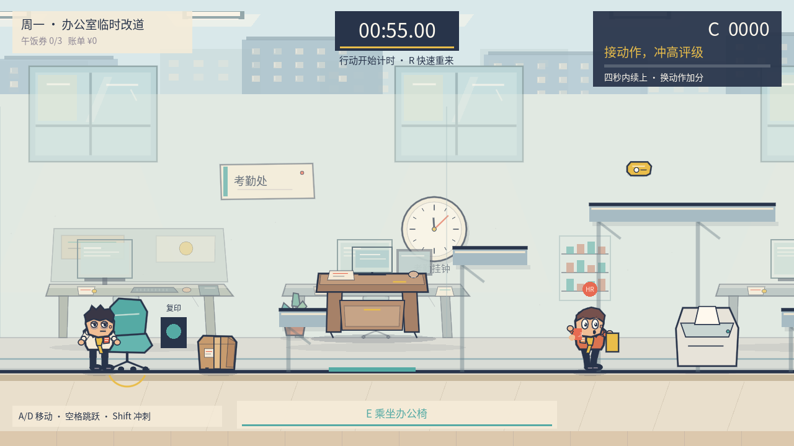

# 上班迟到大作战

使用 Godot 4.7 和 GDScript 开发的单人 2D 办公室动作喜剧游戏。玩家需要在倒计时结束或被人事登记迟到前，赶到工位并打卡，保住五十元全勤奖。

当前玩法版本为 1.4。项目包含入职教学和周一至周五六个关卡，支持本地存档、关卡解锁、宽松模式、午饭券收集和名场面图鉴。

## 玩法

周一提供上层绕行、声音诱饵、骑椅撞击、滚桶连锁、装忙、喷粉遮挡、推桌和门禁等选择。准时打卡即可过关，连续完成不同动作可以提高精彩评分和评级。

## 在编辑器中运行

1. 安装 Godot 4.7 标准版，无需 .NET 版本。
2. 克隆仓库，在 Godot 项目管理器中导入根目录的 `project.godot`。
3. 等待资源导入完成后按 F5，进入标题菜单开始游戏。

项目采用 Compatibility 渲染器，默认画面尺寸为 1280 × 720，主要面向 Windows 键盘操作。

## 操作

| 按键 | 操作 |
| --- | --- |
| A / D、左右方向键 | 移动、载具蹬地、推动会议桌 |
| 空格 | 跳跃，短按可降低跳跃高度 |
| Shift | 地面短冲刺 |
| S、下方向键 | 刹车 |
| E | 乘坐、拿放道具、工位附近打卡 |
| Q（按住） | 在绿色日报点装忙 |
| F | 操作设备、踢出载具、喷粉 |
| R | 重开本关 |
| Esc | 暂停或返回 |

## 项目结构

| 目录 / 文件 | 内容 |
| --- | --- |
| `scripts/` | 角色移动、人事行为、关卡、绘图、音效、界面和存档 |
| `scenes/main.tscn` | 游戏主场景 |
| `assets/fonts/` | 中文字体及其许可 |
| `verification/` | 自动检查脚本、部分实机截图和现有验收报告 |
| `export_presets.cfg` | Windows 导出配置 |

详细规则见[游戏说明](游戏说明.md)，设计见[游戏开发计划](游戏开发计划.md)，历史验证范围见[验收结果](验收结果.md)。验收报告记录的是此前运行结果；将项目上传到 GitHub 不代表重新完成了游戏回归测试。部分旧测试针对历史玩法，当前规则以说明文档和最新验收章节为准。

## 导出 Windows 版本

在 Godot 中安装对应版本的导出模板，打开“项目 → 导出”，使用已有的 Windows Desktop 预设导出。未嵌入 PCK 时，运行文件需要与同名 `.pck` 放在同一目录。

源码仓库排除了 `.godot/` 缓存、`dist/` 成品包、运行日志、测试存档和历史备份。Windows 便携成品可以通过 GitHub Releases 单独分发。

存档位于 Godot 的 `user://progress.json`，不包含在本仓库中。

## 第三方资源

字体使用思源黑体，许可见 [`assets/fonts/LICENSE.txt`](assets/fonts/LICENSE.txt)。Godot 引擎及导出运行程序的第三方许可应随成品一并分发。游戏源码尚未指定开源许可证。
